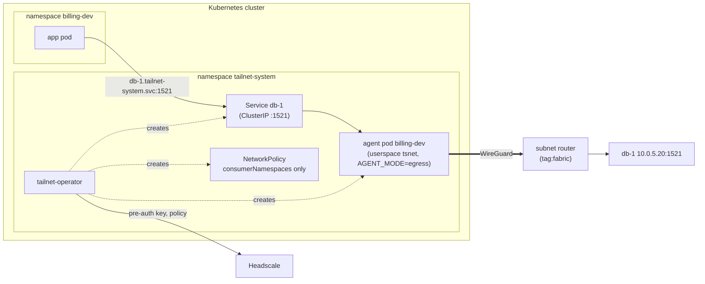
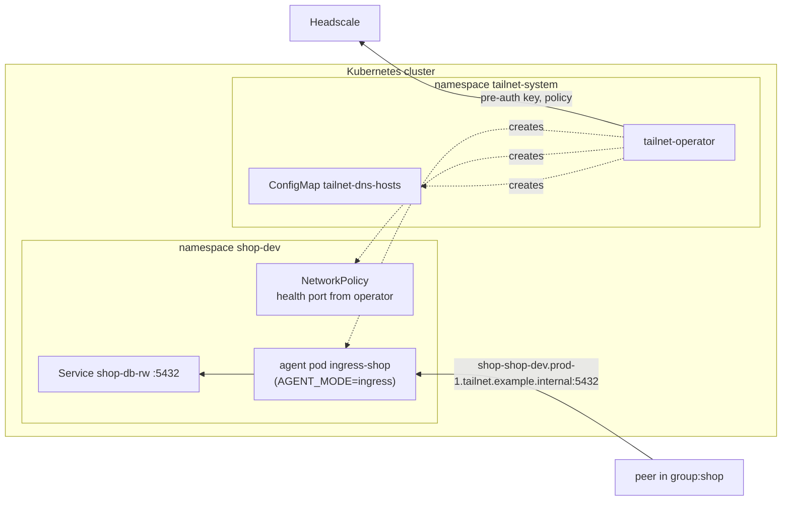
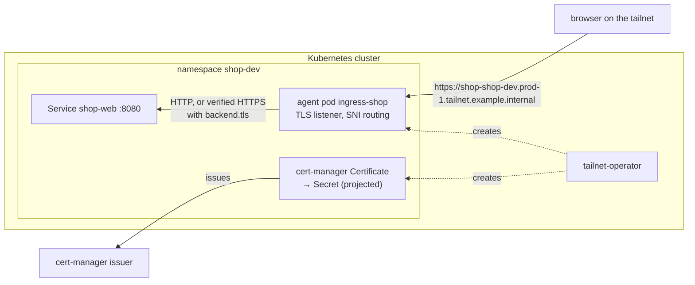
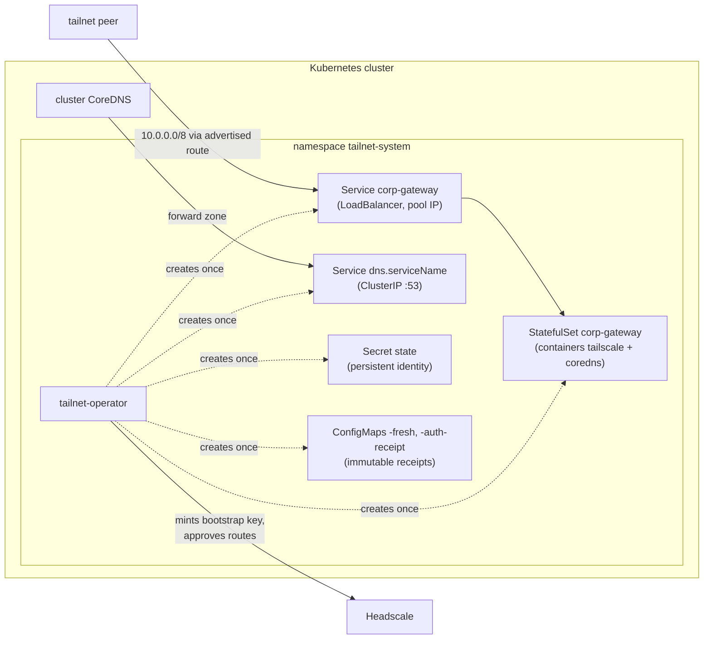
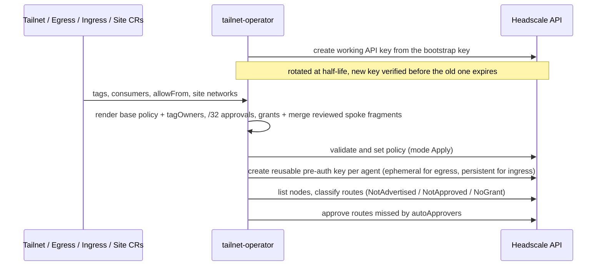

Each scenario below shows the cluster boundary, the operator, the agent it runs and the objects it
creates, and the peer on the far side of the tailnet. The diagrams render on the website; in a
plain Markdown viewer they appear as Mermaid source. [Model and how it works](model.md) explains
the kinds and the reconcilers in prose; this page shows the resulting shape.

Conventions: `corp` is the Tailnet, `tailnet-system` the operator namespace, `billing-dev` and
`shop-dev` tenant namespaces.

## Egress: a namespace reaches a host at the site

`TailnetEgress billing-dev` yields one agent Deployment, one Service per target and a
NetworkPolicy that admits only the listed consumer namespaces. The agent registers as
`egress-billing-dev` with `tag:egress-billing-dev`, accepts the site routes and `Dial`s the target
over the tailnet; the operator derives the tag owner and the grant from the CR.

## Ingress: tailnet peers reach a cluster Service

`TailnetIngress shop` lives in the tenant namespace. Its agent listens on the tailnet as one node
(`ingress-shop`, `tag:ingress-shop`) and forwards to the backend Service; `allowFrom` becomes the
grant, and the DNS name is written into the hosts ConfigMap for the cluster's CoreDNS.

## Ingress `mode: http`: TLS terminated on the agent

Each `mode: http` expose is a virtual host: the agent terminates TLS with the certificate the
operator requested from cert-manager (or a Secret you supply), routes by SNI and Host, and
forwards HTTP/1.1 or HTTP/2 to the backend — plain, or HTTPS verified against `backend.tls`.

## Gateway: subnet router and split-DNS as a CR

`TailnetGateway` is the one persistent identity: created exactly once, pinned by receipts, never
restarted or adopted by the operator. Route changes flow into the StatefulSet template, the hosts
file into the CoreDNS zone. Deleting the CR removes nothing unless `deletionPolicy: Delete`.

## Policy and keys: what the operator says to Headscale

Everything the operator writes to Headscale is derived from CRs and visible beforehand: the
rendered policy lands in a ConfigMap, `DryRun` shows it without writing. A second cluster that shares
the Headscale cannot write; in `mode: Export` it renders only its own entries into a fragment
ConfigMap, which the single Apply writer merges after review — see
[Second cluster](../how-to/policy.md#second-cluster-export-on-the-spoke-merge-on-the-hub).

## What the operator creates

| CR | Kubernetes objects (owned, garbage-collected with the CR) | Headscale side | On delete |
| --- | --- | --- | --- |
| `Tailnet corp` | Secret `corp-apikey` (working key, expiry in annotations); with `dns`: ConfigMap `spec.dns.hostsConfigMap`; with `policy`: ConfigMap `<base>-rendered` | API keys created and expired on rotation; policy written in `Apply` | Secret and ConfigMaps go; the live policy and keys stay as they are |
| `TailnetEgress billing-dev` | Deployment `billing-dev`, ConfigMap `billing-dev-targets`, Secret `billing-dev-authkey`, one Service per target (named after the target), NetworkPolicy `billing-dev` | Pre-auth key (reusable, ephemeral, rotated); node `egress-billing-dev`; stale offline duplicates removed | Objects are garbage-collected; the ephemeral node ages out |
| `TailnetIngress shop` | Deployment `ingress-shop`, ConfigMap `shop-targets`, Secret `shop-authkey`, NetworkPolicy `ingress-shop`, ServiceAccount/Role/RoleBinding `ingress-shop`, state Secret `ingress-shop-state-<hash>`; `mode: http` with an issuer: cert-manager Certificate and its TLS Secret | Pre-auth key (reusable, non-ephemeral, rotated); persistent node `ingress-shop`; DNS name in the hosts file | Objects are garbage-collected; the operator deletes the node (best effort, before the finalizer is dropped) |
| `TailnetGateway corp-gateway` | StatefulSet, headless Service, LoadBalancer Service, DNS ClusterIP Service, CoreDNS ConfigMap, ServiceAccount, Role, RoleBinding, PDB; state Secret and auth Secret; receipt ConfigMaps — none with an owner reference | Non-ephemeral bootstrap key; persistent node; approved routes | `Retain` (default): nothing; `Delete`: fail-closed teardown of what this Gateway provably created |
| `TailnetSite` | none | `autoApprovers` and approvals for the declared network | Rendered policy loses the entries |
| `TailnetGrant` | none | One grant in the rendered policy while the target is valid and `expiresAt` has not passed | Rendered policy loses the grant at the next policy reconcile |

Names and labels follow the CR name; selectors are per CR, so two CRs never share a pod. For the
field-level view see the [CRD reference](../reference/crds.md), for the gateway's exact contract
the [TailnetGateway reference](../reference/gateway.md).
